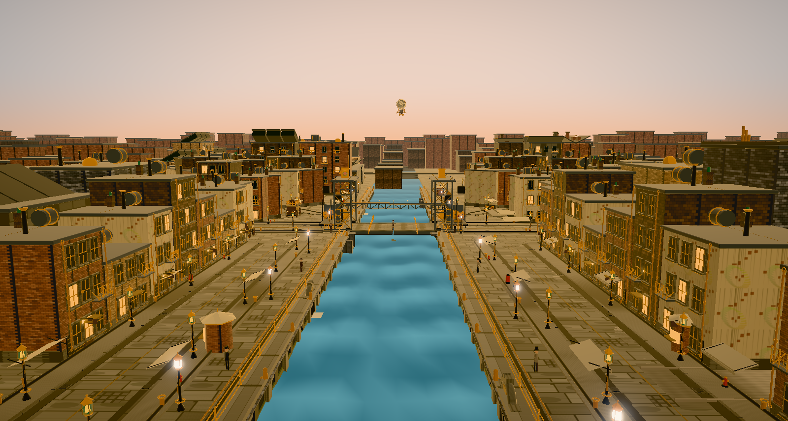
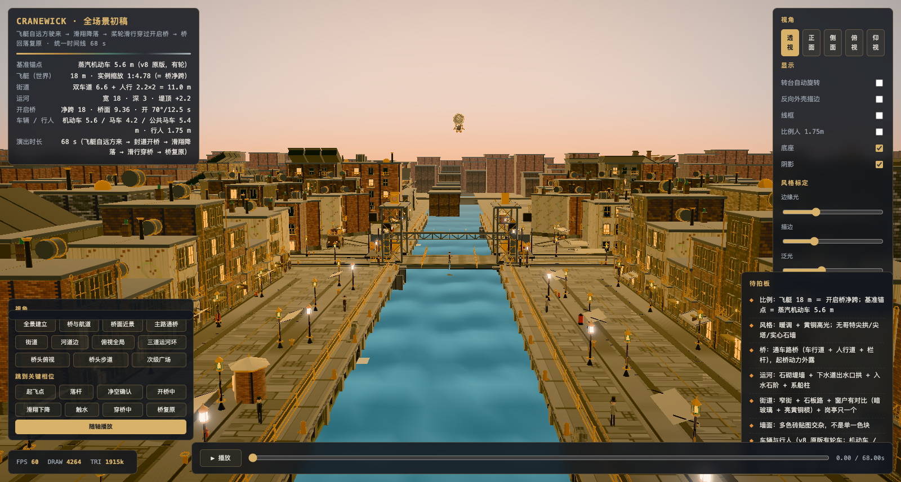

# CRANEWICK — 蒸汽朋克近未来城市 · three.js 网页三维场景

以蒸汽机等工业革命机械构建的**近未来科幻**体系（蒸汽朋克），核心演出为
「通车开启桥起桥让出航道 → 飞艇降落水面溅起水花」。全部几何体由代码程序化生成，
不依赖任何外部模型文件，three.js r186 已本地化到 `vendor/`。





> **风格准绳**：[`docs/STYLE_PROMPT.md`](./docs/STYLE_PROMPT.md)（硬约束 S1–S10 · §7 已否决清单）
> **美术全书**：[`docs/ART_BIBLE.md`](./docs/ART_BIBLE.md) · **锁定决策**：[`docs/DECISIONS.md`](./docs/DECISIONS.md)

---

## 快速开始

### 方式一：只看效果（零依赖，离线可跑）

双击 **`canal_airship.html`**。

它是完整自包含的最终成品：three.js 与全部几何数据内联在同一个文件里（约 900 KB），
不需要服务器、不需要联网、不需要构建步骤。

### 方式二：看模块化源码 / 修改

`index.html` 与 `preview/*.html` 通过 ES module 从 `src/` 按需 `import`。
浏览器在 `file://` 协议下**禁止跨文件 import**（CORS），直接双击会白屏，需要起一个本地 HTTP 服务：

```bash
python3 tools/devserver.py 8817
# 打开 http://localhost:8817/index.html
```

`tools/devserver.py` 对所有代码类文件回 `Cache-Control: no-store`。
用 `python3 -m http.server` 会把 ES module 启发式缓存住，症状是"改了代码却还是旧版"。

| 页面 | 内容 |
|---|---|
| `index.html` | 全场景 + 64 s 时间线 |
| `preview/airship.html` | ① 飞艇 HMS PENDRAGON |
| `preview/bridge.html` | ② 仰开式开启桥 |
| `preview/bridge_roll.html` | ②b 滚开式钢桁架桥（存档方案） |
| `preview/street.html` | ③ 街道 |
| `preview/vehicles.html` | ④ 车辆与行人 |
| `preview/canal.html` | ⑤ 运河与河堤 |
| `preview/citykit.html` | ⑥ 城市建筑套件 |
| `studio/index.html` | 运镜录制台 |

> `canal_airship_fix.html` 是渲染管线（Blender 导出）使用的模型源，与 `canal_airship.html` 保持同步。

---

## 目录

```
canal_airship.html          单文件成品（离线可跑）
canal_airship_fix.html      渲染管线模型源
index.html                  全场景（时间线 64 s）
preview/                    ①–⑥ 单资产预览页
studio/index.html           运镜录制台
src/core/                   scale（世界尺度唯一来源）· palette · materials · textures（程序化墙面）
                            primitives · viewer · stage · audit（扫掠/悬空审计）· io
src/assets/                 airship · bridge · street · canal · vehicles · citykit
src/scene/assemble.js       全场景合成 + 64 s 时间线
tools/                      verify · stamp · checkhtml · contracts · materials · devserver
tools/blender/              Blender 建模 / 导出的管线脚本
vendor/                     three.js r186（本地化）
renders/presets/            四时段锁定光照参数
renders/textures/           水面法线等贴图输入
docs/                       STYLE_PROMPT · ART_BIBLE · DECISIONS · SHOT_SCRIPT
```

> 成片与渲染样张体积较大，未包含在本仓库。

---

## 自检工具（改完代码跑这一条）

```bash
node tools/verify.mjs
```

串起六道闸，全绿才算可交付：

| # | 闸 | 作用 |
|---|---|---|
| 1 | JS 语法 | 所有 `.js` / `.mjs` 过 `node --check` |
| 2 | HTML 内联脚本语法 | 提取每个 `<script type="module">` 单独校验 —— **HTML 里的语法错误会让整张模块图静默失败** |
| 3 | 页面 ↔ 资产接口契约 | 页面引用的 `SPEC.*` / `userData.parts.*` / `snapshot()` 字段是否真实存在 |
| 4 | import 路径可达 | 每个相对 import 是否命中真实文件（HTML 按浏览器 URL 语义解析） |
| 5 | 材质表键 / 工厂方法 | `MT.xxx` 引用的键是否存在 —— 缺键时 `THREE.Mesh(geo, undefined)` 会**静默退化成默认 MeshBasicMaterial（恒亮）**，表现是"零件在发光" |
| 6 | 台账 + 缓存击穿 | 刷新 `build-info.json`，并给每页模块 import 写入 `?v=` 标记 |

单独使用：

- `node tools/stamp.mjs` — 只刷台账与缓存标记
- `node tools/checkhtml.mjs` — 只查 HTML 内联脚本语法
- `node tools/contracts.mjs` — 只查接口契约
- `node tools/materials.mjs` — 只查材质表键与工厂方法

> 本项目曾三次出现「资产接口改了、页面没跟上」，以及一次 HTML 内联脚本语法错误导致整页静默卡在遮罩。
> 这两类都能静态查出来，但前提是每次都查。

---

## 比例尺

飞艇模型内部尺寸为 86 m，改变的是它在世界里的**实例尺度**：

| 对象 | 世界尺寸 | 说明 |
|---|---|---|
| 蒸汽机动车 | 长 5.6 m | **基准尺度锚点** |
| **飞艇** | **长 ≈ 18 m** | 与开启桥净跨同尺度（实例缩放 1 : 4.78） |
| 街道 | 双车道 6.6 m + 人行道 2 × 2.2 m = 11.0 m | 威尼斯式窄街 |
| 运河 | 宽 18 m · 深 3 m · 堤顶 +2.2 m | 可通航小艇 |
| 开启桥 | 净跨 18 m · 桥面 9.36 m · 开 70°/12.5 s | 路桥，非城堡 |
| 行人 | 1.75 m | — |

> 改这张表等于改整个世界的尺度。任何尺寸改动都要重算与飞艇的比例关系，
> 并回头检查所有"与长度相关的公式"。

---

## 当前状态

| 资产 | 状态 | 说明 |
|---|---|---|
| ① 飞艇 | ✅ 已放大 | 模型内部 86 m 不变；世界内 1 : 4.78（全长 18 m = 开启桥通航净跨）。侧桅帆可收 · 侧桨轮可折 · **滑翔降落**（下滑 −9.2° → 拉平 +5.8°）· 下降时沿河道前进 26 m · 方向性溅射与前进方向对应 |
| ② 开启桥（仰开式） | ✅ 力学已通 | 18 m 净跨通车路桥 + 机械桁架。扫掠审计确认桥叶 0→70° 无真实干涉 |
| ②b 开启桥（滚开式） | ⏸ 存档 | 代码与预览页保留。已验证：枢轴位移逐点 = R·θ、轮底贴轨偏差 0、配重不撞坑 |
| ③ 街道 | ✅ 已重做 | 11 m 窄街 · 石板路 · 排水格栅 · 窗户对比三件套 |
| ④ 车辆行人 | ✅ | 有轮三型：蒸汽机动车 5.6 / 蒸汽马车 4.2 / 双层公共马车 5.4 m，辐条车轮按行驶距离纯滚动 |
| ⑤ 运河 | ✅ | 宽 18 / 深 3 · 石砌堤墙 + 压顶 + 壁柱 · 下水道出水口拱 ×4 · 入水石阶 |
| ⑥ 城市套件 | ✅ | 居民楼 / 小别墅 / 工厂（蒸馏塔 + 管廊 + 流水线）/ 广场（中央发电塔） |
| ⑦ 城市肌理 | ✅ | 按真实城市布鲁日的建筑关系填充（`src/scene/cityplan.js`）：广场四周连续围合 · 运河紧贴广场 · 街道自广场放射 · 靠运河的巷道更窄 · 天际线用烟囱与发电塔。共 56 栋 + 广场 + 工厂 + 4 巷道 + 8 街段 |

### 性能（实测）

| 指标 | 优化前 | 优化后 |
|---|---|---|
| 全场景首屏 | 30–60 s | **2–3 s** |
| draw call | 4280 | **2257–3139**（随视角） |
| 三角形 | 1876k | **911k–1075k** |
| 帧率 | 24–60 fps | **60 fps** |

首屏从 30–60 s 压到 2–3 s 的真因不是合批慢（实测街道 build 38 ms / merge 25 ms / 克隆 6 ms），
而是 viewer 又给整场景加了一遍描边 —— 4000+ 次几何克隆。关掉重复描边即解决。

### 已知未完成

1. 城市肌理继续向南北延伸（受 draw call 约束）
2. 同心运河环与 Burg 次级广场尚未落地
3. 桥门架重做后约 9 处悬空小件（孤立小岛）待逐个定位
4. `street.html` 单页 2597 draw call 需合并优化
5. 全场景进一步降 draw call 需引入 InstancedMesh 批

---

## 许可

**保留所有权利（All Rights Reserved）**。可阅读、学习、本地运行；
未经许可不得商用、再分发或发布衍生作品。详见 [`LICENSE`](./LICENSE)。
